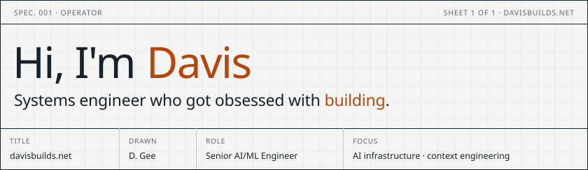
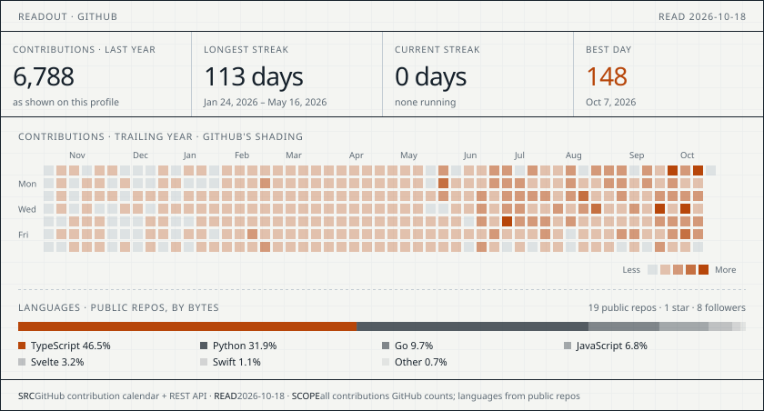

<!-- Images are generated by scripts/render_profile.py; see .github/workflows/profile.yml. -->
<picture>
  <source media="(prefers-color-scheme: dark)" srcset="./profile/masthead-dark.svg">
  
</picture>

### Projects

| P/N | Project | Function | Lang |
| --- | --- | --- | --- |
| `AMON` | [agentmonitor](https://github.com/davisbuilds/agentmonitor) | Local observability for coding agents: sessions, tool calls, costs, search | TypeScript |
| `DOJO` | [dojo](https://github.com/davisbuilds/dojo) | Cross-harness skills, hooks, generated adapters, contract validation | Python |
| `ENGRAM` | [engram](https://github.com/davisbuilds/engram) | One canonical markdown memory store rendered into Claude Code and Codex | Go |
| `OPENBENCH` | [openbench](https://github.com/davisbuilds/openbench) | Same model, different wrapper: harness benchmark on correctness, speed, cost | Python |
| `FETCHMD` | [fetchmd](https://github.com/davisbuilds/fetchmd) | Token-efficient webpage-to-Markdown CLI for agents | TypeScript |
| `ENVDIFF` | [envdiff](https://github.com/davisbuilds/envdiff) | Deterministic environment-contract analysis for repositories | Go |
| `ONESHOTS` | [oneshots](https://github.com/davisbuilds/oneshots) | Single-file capability demos, each labeled with the model that built it | Python |
| `MLSEARCH` | [mlsearch](https://github.com/davisbuilds/mlsearch) | Autoresearch experiment in semantic search over arXiv cs.LG | Python |
| `PODSAVE` | [podsave](https://github.com/davisbuilds/podsave) | A YouTube URL becomes a curated Obsidian note | Python |
| `FEED` | [feed](https://github.com/davisbuilds/feed) | Newsletter digest CLI | Python |
| `COMPEND` | [compendium](https://github.com/davisbuilds/compendium) | A curated collection of advice from successful entrepreneurs | TypeScript |
| `SITE` | [davisbuilds.net](https://github.com/davisbuilds/davisbuilds.net) | The source for davisbuilds.net, a static Astro build | TypeScript |

<picture>
  <source media="(prefers-color-scheme: dark)" srcset="./profile/readout-dark.svg">
  
</picture>
